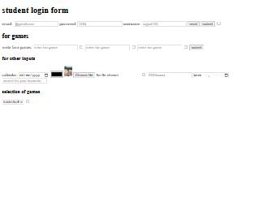
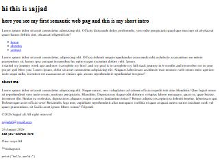
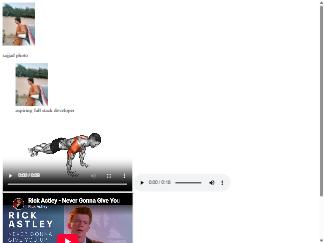

# HTML Practice

My hand-coded HTML exercises from the start of my full-stack web development journey. These are plain, unstyled HTML files on purpose. The focus here was structure, semantics and the full range of HTML elements, before adding any CSS.

## Pages

| File | What it covers |
|------|----------------|
| `01_intro.html` | First HTML page, boilerplate, basic tags |
| `02_headings_list.html` | Headings, paragraphs, images, links, ordered and unordered lists |
| `03_table.html` | Tables — `table`, `tr`, `th`, `td` |
| `04_form.html` | Forms — many input types, labels, select, submit and reset |
| `05_semantics.html` | Semantic HTML — `header`, `nav`, `main`, `section`, `article`, `footer` |
| `media.html` | Media — `img`, `figure` / `figcaption`, `video`, `audio`, YouTube `iframe` |

### Form — `04_form.html`

### Semantic page — `05_semantics.html`

### Media elements — `media.html`

## What I learned
- The full structure of an HTML document and the common elements.
- Form inputs — text, email, password, checkbox, radio, date, color, file and more — with proper labels and ids.
- Semantic tags and why they matter for structure and accessibility.
- Embedding images, video, audio and iframes.

## About
Computer Science student learning full-stack web development. These are my earliest exercises, kept here to track the journey. Everything is hand-coded.
